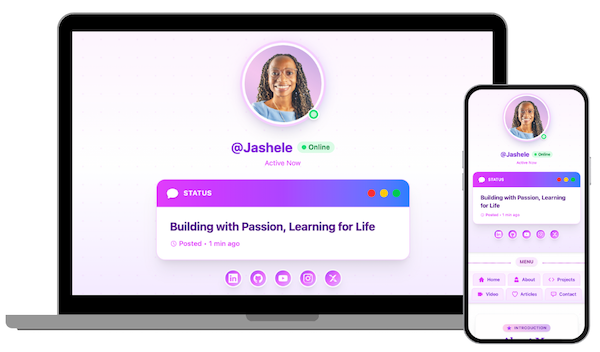
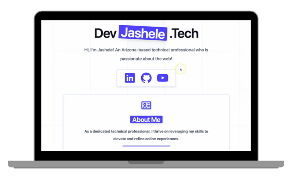

# Portfolio Website - Version 2.0

### 🔗 Link
https://jasheloper.github.io/portfolio/
  

 

### 💬 About
My personal portfolio website to showcase my technical work and career journey.
  

### 🧩 Features
- Highlights my skills, projects, and professional story with a clean, modern design.
- Features social media–inspired elements like an online status and status update header.
  

### ⚙️ Technologies
HTML, Tailwind CSS
  

## Previous Versions

**Version 1.0** : A single-page layout with distinct sections showcasing my professional summary, skills, and projects. A minimalist design that presents key information concisely to keep users engaged with a user-friendly experience.

https://jasheloper.github.io/portfolio/v1/v1.html

